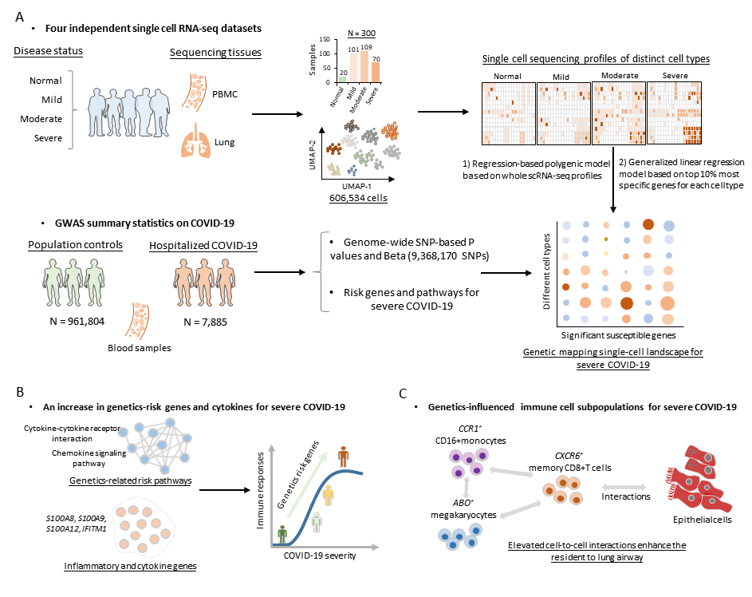

## Analyzed codes for the immune response of severe COVID-19 using scRNA-seq data

Here we submitted codes and methods on the manuscript entitled "Integrating single cell sequencing data with GWAS summary statistics reveals CD16+ monocytes and memory CD8+T cells involved in severe COVID-19", which has been published in [Genome Medicine, 2022](https://genomemedicine.biomedcentral.com/articles/10.1186/s13073-022-01021-1).


# All COVID-19-related projects in our group:
1) Meta-analysis of large-scale GWAS data to uncover novel loci for COVID-19. see [Ma et al. Human Molecular Genetics, 2021](https://academic.oup.com/hmg/article/30/13/1247/6265026), and see related [Github codes](https://github.com/mayunlong89/Host_genetics_for_COVID-19).
2) COVID-19 Quarantine Reveals That Behavioral Changes Have an Effect on Myopia Progression. see [Xu, Ma et al. Ophthalmology, 2021](https://www.sciencedirect.com/science/article/pii/S0161642021002578), see related [Github codes](https://github.com/mayunlong89/MIES).
3) Identification of genetics-influenced immune cell sub-populations relevant to severe COVID-19. see [Ma et al. Genome Medicine, 2022](https://link.springer.com/article/10.1186/s13073-022-01021-1), and see related [Github codes](https://github.com/mayunlong89/COVID19_scRNA).
4) Repurposing cell type-specific durg targets for severe COVID-19 based on human organoids scRNA-seq atlas. see [Ma et al. Cell Proliferation, 2023](https://onlinelibrary.wiley.com/doi/full/10.1111/cpr.13558), and see related [Github codes](https://github.com/mayunlong89/scHuman_organoids_COVID19)
5) Development of novel polygenic regression method scPagwas for integrating scRNA-seq data with GWAS on complex diseases. see [Ma et al. Cell Genomics, 2023](https://www.cell.com/cell-genomics/fulltext/S2666-979X(23)00180-5), and see related [Github codes](https://github.com/mayunlong89/scPagwas_main)

# Abstract
Background: Understanding the host genetic architecture and viral immunity contributes to the development of effective vaccines and therapeutics for controlling the COVID-19 pandemic. Alterations of immune responses in peripheral blood mononuclear cells play a crucial role in the detrimental progression of COVID-19. However, the effects of host genetic factors on immune responses for severe COVID-19 remain largely unknown. 
Methods: We constructed a computational framework to characterize the host genetics that influence immune cell subpopulations for severe COVID-19 by integrating GWAS summary statistics (N = 969,689 samples) with four independent scRNA-seq datasets containing healthy controls and patients with mild, moderate, and severe symptom (N = 606,534 cells). We collected 10 pre-defined gene sets including inflammatory and cytokine genes to calculate cell state score for evaluating the immunological features of individual immune cells.
Results: We found that 34 risk genes were significantly associated with severe COVID-19, and the number of highly-expressed genes increased with the severity of COVID-19. Three cell-subtypes that are CD16+monocytes, megakaryocytes, and memory CD8+T cells were significantly enriched by COVID-19-related genetic association signals. Notably, three causal risk genes of CCR1, CXCR6, and ABO were highly expressed in these three cell types, respectively. CCR1+CD16+monocytes and ABO+ megakaryocytes with significantly up-regulated genes, including S100A12, S100A8, S100A9, and IFITM1, confer higher risk to the dysregulated immune response among severe patients. CXCR6+ memory CD8+ T cells exhibit a notable polyfunctionality including elevation of proliferation, migration, and chemotaxis. Moreover, we observed an increase in cell-cell interactions of both CCR1+ CD16+monocytes and CXCR6+ memory CD8+T cells in severe patients compared to normal controls among both PBMCs and lung tissues. The enhanced interactions of CXCR6+ memory CD8+T cells with epithelial cells facilitates the recruitment of this specific population of T cells to airways, promoting CD8+T cells mediated immunity against COVID-19 infection.
Conclusions: We uncover a major genetics-modulated immunological shift between mild and severe infection, including an elevated expression of genetics-risk genes, increase in inflammatory cytokines, and of functional immune cell subsets aggravating disease severity, which provides novel insights into parsing the host genetic determinants that influence peripheral immune cells in severe COVID-19.



# Introduction
Accumulating evidence have suggested alterations of immune responses in peripheral blood mononuclear cells (PBMCs) play a crucial role in the detrimental progression of COVID-19. A growing number of GWASs have identified numerous significant genetic variants associated with COVID-19 susceptibility and severity. Many earlier GWASs have shown that complex genetic dysregulations of peripheral immune cells with highly selective effects on the risk of immune-related diseases at the subcellular level. However, the effect of these genetic determinants on the peripheral immune cells for severe COVID-19 remains largely unknown. In light of there is no comprehensive study for revealing the genetically regulatory effects of peripheral immune cells on severe COVID-19, the present study is the first integrative genomic analysis by combining genetic information from GWAS with scRNA-seq data to genetically pinpoint immune cell types implicated in the etiology of severe COVID-19. 

# Methods
## 1. Single cell RNA-seq data on severe COVID-19  
In the current study, we downloaded four independent scRNA-seq datasets on COVID-19 and its severity in PBMC and BALF from the ArrayExpress database (Dataset #1: the accession number is E-MTAB-9357) from Su et al. study [11], and the Gene Expression Omnibus (GEO) database (Dataset #2: the accession number is GSE149689 from Lee et al. study [20], Dataset #3: the accession number is GSE150861 from Guo et al. study [12], and Dataset #4: the accession number is GSE158055 [9]). For dataset #1, this dataset contained 270 peripheral blood samples including 254 samples with different COVID-19 severity (i.e., mild N = 109, moderate N = 102, and severe N = 50) and 16 healthy controls for scRNA-seq analysis. For the dataset #2, there were eight patients with COVID-19 of varying clinical severity, including asymptomatic, mild, and severe, and four healthy controls with PBMCs. As for the dataset #3, there were five peripheral blood samples from two severe COVID-19 patients at three different time points during tocilizumab treatment, containing two different stages: severe stage and remission stage. With regard to the dataset #4, there were 12 BALF samples including three moderate and nine severe patients collected from lung tissues. For all datasets, the sample collection process underwent Institutional Review Board review and approval at the institutions where samples were originally collected. The COVID-19 severity was qualified by using the World Health Organization (WHO) ordinal scale (WOS), the National Early Warning Score (NEWS), or the Diagnosis and Treatment of COVID-19 (Trail Version 6). Single-cell transcriptomes for these four datasets were gathered by using the 10× Genomics scRNA-seq platform. 

## 2. GWAS summary statistics from the COVID-19 Host Genetic Consortium
  The meta-GWAS summary data on severe COVID-19 round 4 (B2_ALL, Susceptibility [Hospitalized COVID-19 vs. Population]) were downloaded from the official website of the COVID-19 Host Genetic Consortium [23] (https://www.covid19hg.org/; analyzed file named: “COVID19_HGI_B2_ALL_leave_23andme_20201020.txt.gz”; released date of October 4 2020). There were 7,885 hospitalized COVID-19 patients and 961,804 control participants from 21 independent contributing studies. The vast majority of participants in these contributing studies were of European ancestry (93%). The meta-GWAS summary statistics contained P values, Wald statistic, inverse-variance meta-analyzed log Odds Ratio (OR) and related standard errors. The 1,000 Genomes Project European Phase 3 [37] were used as a panel for pruning. Results from 23&Me cohort GWAS summary statistics were excluded from our current analysis. By filtering genetic variants without RefSNP number in the Human Genome reference builds 37, there were 9,368,170 genetic variants included with a major allele frequency (MAF) threshold of 0.0001 and the imputation score filter of 0.6. We used the qqman R package for figuring the Manhattan plot to visualize the meta-GWAS analysis results. The web-based software of LocusZoom [38] was utilized to visualize the regional association plots for identified risk loci (http://locuszoom.sph.umich.edu/).
  
 ## 3. Scripts:
  In the present sutyd, we leveraged numerous bioinformatics tools: linux-based tools incluidng MAGMA, S-MultiXcan, R-based tools including Rolypoly and permutation, and web-access tools inclduing the WEB-based Gene SeT AnaLysis Toolkit (WebGestalt; http://www.webgestalt.org) [42], the PhenoScanner V2 (http://www.phenoscanner.medschl.cam.ac.uk/) [45],  the Open Target Genetics (OTG, https://genetics.opentargets.org/) [46], STRING(v11.0, https://string-db.org/)[51], STITCH (v5.0, http://stitch.embl.de/)[53],ChEMBL (v2.6, https://www.ebi.ac.uk/chembl/) [54], and DGIdb database (https://www.dgidb.org/druggable_gene_categories). 
  In order to ensure our peers could follow our analyses, we have deposited the codes and methods in the current github, as the following example:
```
#compute rolypoly
######################
library("rolypoly")
library("data.table")
#
index<-c("normal","mild","moderate","severe")
lapply(index,function(x){
  file_n<-paste0("/share/pub/dengcy/Singlecell/COVID19/data/Rploy_",x,"_cell.txt")
  merge_scexpr<-read.delim(file_n,sep = " ")
  colnames(merge_scexpr)<-annotation$V2
  merge_scexpr<-merge_scexpr[apply(merge_scexpr,1,sum)!=0,]
  #create the annotation files
  gene_name<-intersect(rownames(merge_scexpr),geneid_df1$label)
  geneid_df1<-geneid_df1[geneid_df1$label %in% gene_name,]
  merge_scexpr<-merge_scexpr[gene_name,]
  geneid_df1<-geneid_df1[!duplicated(geneid_df1$label),]
#############################################
  file_na<-paste0("roly_",x,"_pre.RData")
  save(geneid_df1,merge_scexpr,file=file_na)
  })

 ld_path <- "/share/pub/dengcy/Singlecell/COVID19/data/LD"

#sim_block_annotation$label<-rownames(merge_scexprc2)[1:1000]
#Rploy_remission_GSE.txt
 rolypoly_result <- rolypoly_roll(
   gwas_data = COVID19_GWAS_autosomes_maf2,
   block_annotation = geneid_df1,
   block_data = merge_scexpr,
   ld_folder =ld_path,
   bootstrap_iters = 100
  )
  save(rolypoly_result,file = "/share/pub/dengcy/Singlecell/COVID19/1.rolypoly_result/rolypoly_mild_cell.RData")
```

Please Cited: Ma et al., Integrating single-cell sequencing data with GWAS summary statistics reveals CD16+monocytes and memory CD8+T cells involved in severe COVID-19. Genome Medicine, 2022 Feb 17;14(1):16. [doi: 10.1186/s13073-022-01021-1](https://link.springer.com/article/10.1186/s13073-022-01021-1).

# Availability of data and materials
All the GWAS summary statistics used in this study can be accessed in the official websites (www.covid19hg.org/results) [22]. The GTEx eQTL data (version 8) were downloaded from Zenodo repository (https://zenodo.org/record/3518299#.Xv6Z6igzbgl) [42]. Four scRNA-seq datasets were downloaded from the GEO database (https://www.ncbi.nlm.nih.gov/gds/?term=GSE149689 [18], https://www.ncbi.nlm.nih.gov/geo/query/acc.cgi?acc=GSE158055 [29], and https://www.ncbi.nlm.nih.gov/gds/?term=GSE150861 [11]) and the ArrayExpress database (https://www.ebi.ac.uk/arrayexpress/experiments/E-MTAB-9357) [10]. All analyzed codes for hypergenometric analysis, hierarchical clustering analysis, in silico permutation analysis, S-PrediXcan, S-MultiXcan, MDS, MAGMA, RolyPoly, scCODA, Cell-ID, and CellChat analysis in the Methods are available in an online GitHub repository at https://github.com/mayunlong89/COVID19_scRNA [40]. 


# Supplementary information
# Additional file 1: 
Supplementary methods
# Additional file 2: 
Table S1: Samples collected from four independent scRNA-seq datasets on COVID-19. Table S2: Selected well-known markers used to define cell types in PBMCs. Table S3: Significant SNPs associated with severe COVID-19 identified by meta-GWAS analysis. Table S4: Replication of these identified loci by using samples with very severe respiratory confirmed COVID-19. Table S5: Significant genes associated with severe COVID-19 identified by MAGMA gene-based association analysis. Table S6: Significant enriched pathways associated with severe COVID-19 identified from MAGMA-based pathway enrichment analysis. Table S7. The 16 significant genes associated with severe COVID-19 identified by S-MultiXcan analysis based on 49 tissues from GTEx consortium. Table S8: The eight significant genes associated with severe COVID-19 identified by S-PrediXcan analysis based on lung and blood tissues. Table S9: The biological pathways enriched by 34 risk genes associated with severe COVID-19. Table S10: The percentage of three severe COVID-19-risk genes expressed in all 13 distinct cell types in PBMCs. Table S11: Summary of inflammatory and cytokine-related genes and genes in two identified KEGG pathways. Table S12: Highly-expressed inflammatory and cytokine genes among CCR1+ CD16+monocytes. Table S13: Pathway enrichment analysis of 351 highly-expressed genes among CCR1+ CD16+monocytes. Table S14: Druggble proteins collected from the ChEMBL database. Table S15: Functional enrichment analysis of 190 up-DEGs associated with severe COVID-19 based on the Reactome database. Table S16: Disease-based enrichment analysis of 190 up-DEGs associated with severe COVID-19 among CCR1+ CD16+monocytes based on the GLAD4U database. Table S17: 190 up-DEGs associated with severe COVID-19 among CCR1+ CD16+monocytes matched in druggable gene categories based on the DGIdb resource. Table S18: Highly-expressed inflammatory and cytokine genes among ABO+ megakaryocytes. Table S19: Pathway enrichment analysis of 424 highly-expressed genes among ABO+ megakaryocytes. Table S20. Disease-term enrichment analysis of 35 up-DEGs associated with severe COVID-19 among ABO+ megakaryocytes based on the GLAD4U database. Table S21: 35 up-DEGs significantly associated with severe COVID-19 among ABO+ megakaryocytes matched in druggable gene categories. Table S22: Pathway enrichment analysis of 158 highly-expressed genes among CXCR6+ memory CD8+T cells. Table S23: GO-terms enrichment analysis of 108 up-DEGs associated with COVID-19 among CXCR6+ memory CD8+T cells.
# Additional file 3: 
Fig. S1. UMP projections of cells in PBMCs from normal controls, mild, moderate, and severe COVID-19 patients by using the Seurat R package (dataset #1). Fig. S2. Heatmap showing levels of well-known marker genes specific for each cell type in PBMCs. Fig. S3. Single-cell transcriptomes of PBMCs from normal controls, mild, moderate, and severe COVID-19 patients. Fig. S4. Hierarchical clustering using the PCC of a normalized transcriptome between controls and patients in cell type resolution. Fig. S5. Boxplots showing percentages of each cell type for PBMCs in donors from healthy control and COVID-19 patients. Fig. S6. scCODA determines the compositional differences of each cell type in PBMCs among donors from healthy control and COVID-19 patients. Fig. S7. Regional association plots for severe COVID-19-associated genetic loci based on meta-GWAS summary data. Fig. S8. Regional association plots for severe COVID-19-associated genetic loci based on meta-GWAS summary data. Fig. S9. Circus plot showing the results of MAGMA-based gene-level association analysis. Fig. S10. The 19 biological pathways enriched from the MAGMA-based pathway enrichment analysis. Fig. S11. High consistence results between MAGMA and S-MultiXcan analysis. Fig. S12. In silico permutation analysis of 100,000 times of random selections. Fig. S13. Multiple independent approaches identify genetics-relevant risk genes associated with severe COVID-19. Fig. S14. Plot of gene-drug interaction analysis for 34 risk genes. Fig. S15. The 10 biological pathways significantly enriched by 34 risk genes based on the KEGG database. Fig. S16. Barplots showing the results of RolyPoly among COVID-19 patients stratified by patient’s age. Fig. S17. Barplots showing the results of RolyPoly among COVID-19 patients stratified by patient’s sex. Fig. S18. Barplots showing the results of RolyPoly among COVID-19 patients stratified by patient’s BMI. Fig. S19. Barplots showing the results of RolyPoly COVID-19 patients stratified by patient’s smoking status. Fig. S20. Cell-ID-based enrichment in GWAS-identified gene signatures (34 genes) of CD16+monocytes and memory CD8+ T cells using scRNA-seq dataset. Fig. S21. Genetics-risk genes influenced three immune cell subsets for severe COVID-19. Fig. S22. Dot plot showing the expressed percent of three risk genes of CXCR6, CCR1, and ABO in each peripheral cell type in PBMCs among severe patients based on two scRNA-seq dataset of #2 and #3. Fig. S23. CCR1+ CD16+monocytes showing higher risk to cytokine storms among COVID-19 patients. Fig. S24. Boxplots showing the difference of inflammatory cytokine score and pathway activation score of CD16+ monocytes among normal controls and COVID-19 groups. Fig. S25. ABO+ megakaryocytes contribute higher risk to cytokine storms among severe COVID-19 patients. Fig. S26. Boxplots showing the difference of inflammatory cytokine score and pathway activation score of and megakaryocytes among normal controls and COVID-19 groups. Fig. S27. Evidence showing the multi-functionality of CXCR6+ memory CD8+T cells for severe COVID-19. Fig. S28. Boxplots showing the different score of several immunological features between CXCR6+ and CXCR6- memory CD8+T cells among normal controls and COVID-19 patients. Fig. S29. Cell-ID-based enrichment in functional terms of CD16+monocytes, megakaryocyte, and memory CD8+ T cells using scRNA-seq dataset. Fig. S30. Differences in the number of predicated cell-to-cell interactions in PBMCs. Fig. S31. Predicted cellular interaction of both CCR1+ CD16+ monocytes and CXCR6+ memory CD8+T cells with other immune cells in PBMCs. Fig. S32. Prediction of cell-to-cell interactions of cells in BALFs. 

# References
# All COVID-19-related projects in our group:
1) Meta-analysis of large-scale GWAS data to uncover novel loci for COVID-19. see [Ma et al. Human Molecular Genetics, 2021](https://academic.oup.com/hmg/article/30/13/1247/6265026), and see related [Github codes](https://github.com/mayunlong89/Host_genetics_for_COVID-19).
2) COVID-19 Quarantine Reveals That Behavioral Changes Have an Effect on Myopia Progression. see [Xu, Ma et al. Ophthalmology, 2021](https://www.sciencedirect.com/science/article/pii/S0161642021002578), see related [Github codes](https://github.com/mayunlong89/MIES).
3) Identification of genetics-influenced immune cell sub-populations relevant to severe COVID-19. see [Ma et al. Genome Medicine, 2022](https://link.springer.com/article/10.1186/s13073-022-01021-1), and see related [Github codes](https://github.com/mayunlong89/COVID19_scRNA).
4) Repurposing cell type-specific durg targets for severe COVID-19 based on human organoids scRNA-seq atlas. see [Ma et al. Cell Proliferation, 2023](https://onlinelibrary.wiley.com/doi/full/10.1111/cpr.13558), and see related [Github codes](https://github.com/mayunlong89/scHuman_organoids_COVID19)
5) Development of novel polygenic regression method scPagwas for integrating scRNA-seq data with GWAS on complex diseases. see [Ma et al. Cell Genomics, 2023](https://www.cell.com/cell-genomics/fulltext/S2666-979X(23)00180-5), and see related [Github codes](https://github.com/mayunlong89/scPagwas_main)
